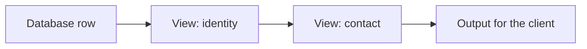

# Expose

**Expose** (`@atom-forge/expose`) is a small TypeScript library that decides what leaves the server: nothing goes to the client unless a *view* names it. When a table gets a new column, that column stays on the server until someone adds it to a view, and the compiler knows the exact shape of what went out.

It has no dependencies and works with any database layer or transport, because a view is a plain function.

> [!abstract] What you will learn
> - how to write a view and build an output from a row,
> - how views overwrite, compose and add to each other,
> - how to organize views in an application,
> - which traps a view can still fall into.

## Who this book is for

TypeScript developers who return database rows from a server to a client and want a new column to stay private by default. Basic TypeScript generics help, but only for writing views that add to a key.

## Reading guide

1. [[getting-started|Getting started]] builds a first output.
2. [[views|Views]] explains naming fields, overwriting, composition and stacking.
3. [[organizing-an-application|Organizing an application]] shows where views live and how they relate to permission checks.
4. [[api-reference|API reference]] lists every export.
5. [[pitfalls|Pitfalls]] collects what the library cannot check for you.
6. [[upgrading|Upgrading]] lists the changes that need action between versions.
7. [AI Notes](ai-notes.md) has instructions to copy into your project's agent instruction file.
